开发者：吴怨吴悔

=============================界面预览（如果无法预览，请查看项目根目录png文件）==========================  
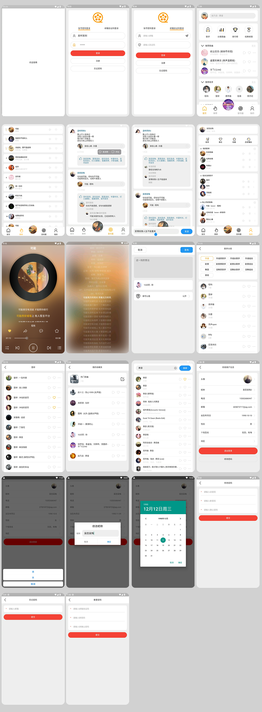
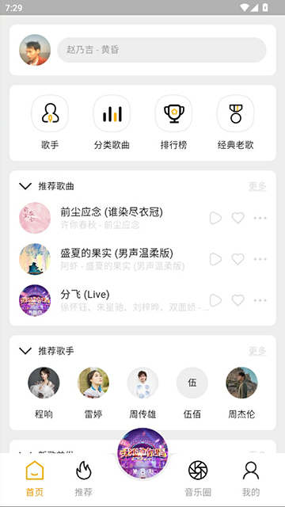
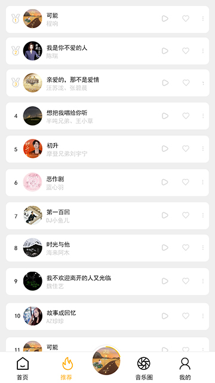
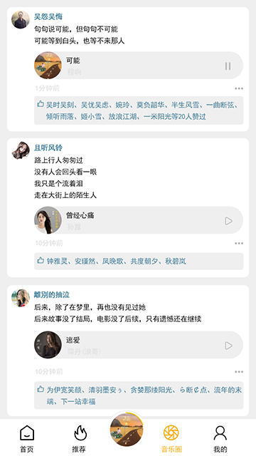
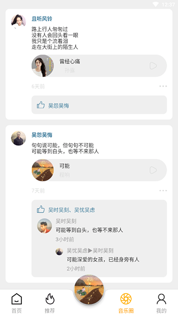
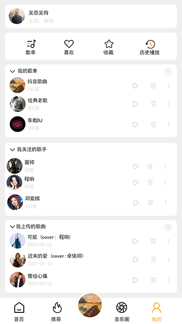
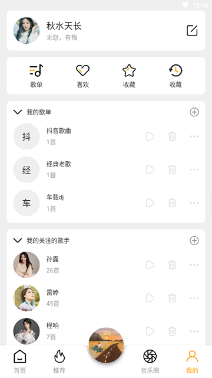

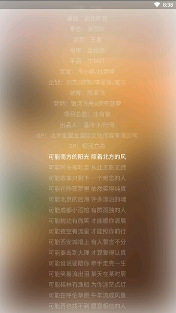
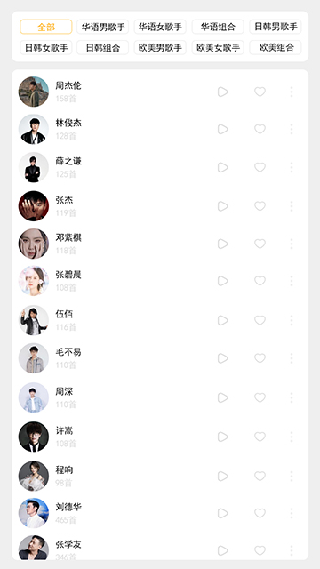
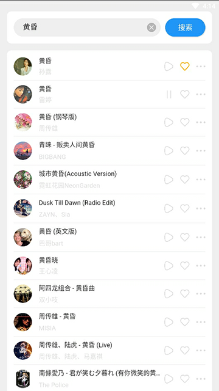


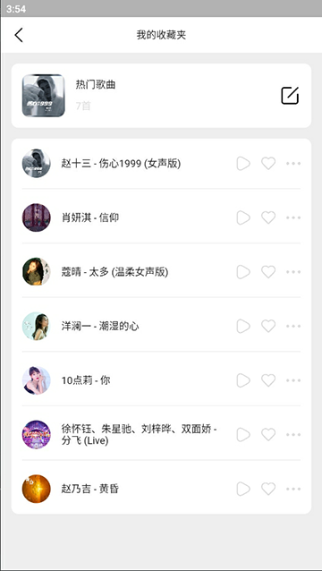
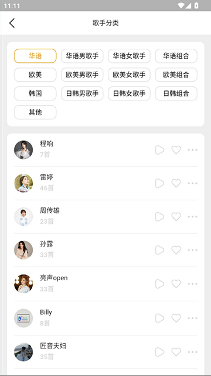
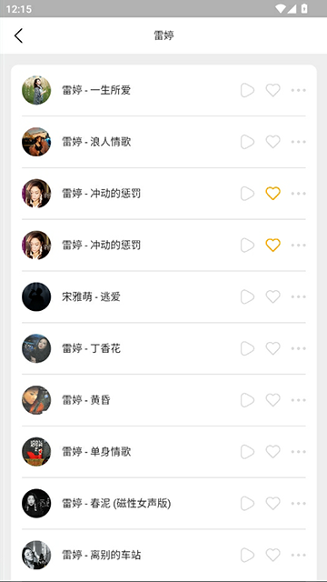
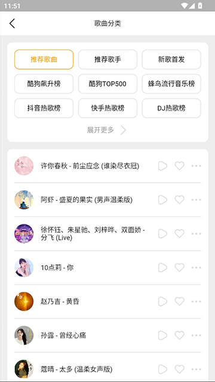
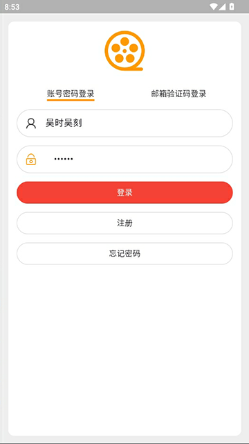
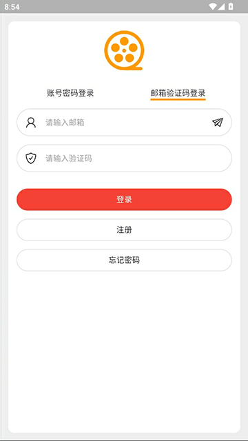
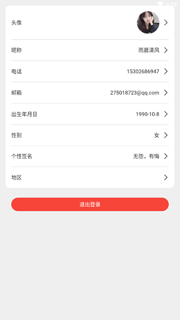
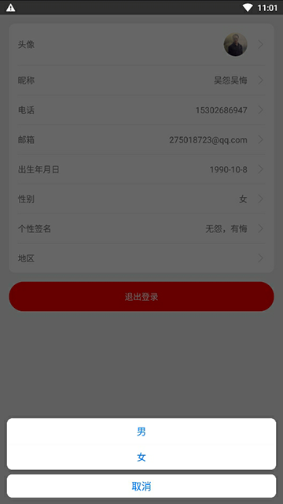
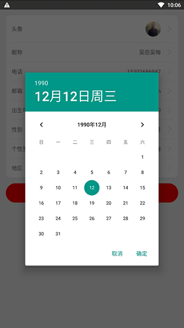
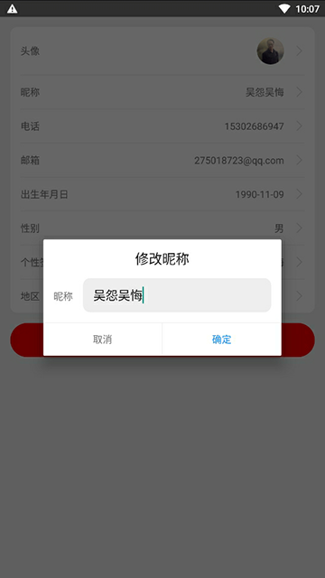
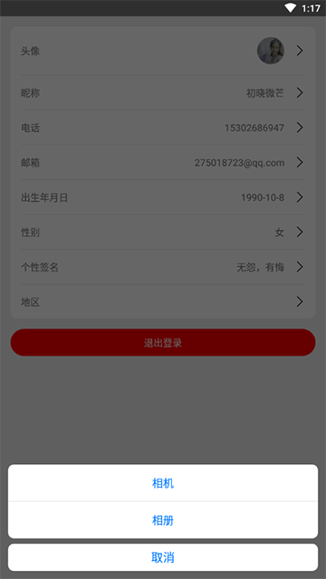
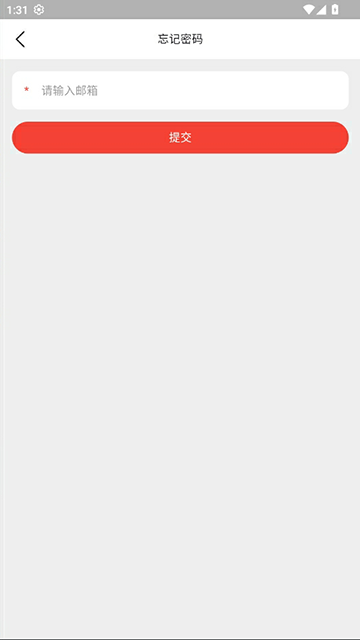
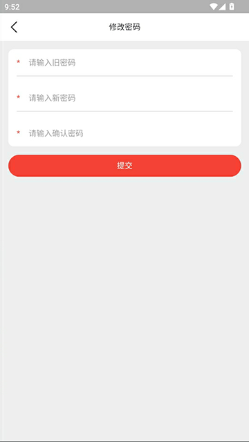
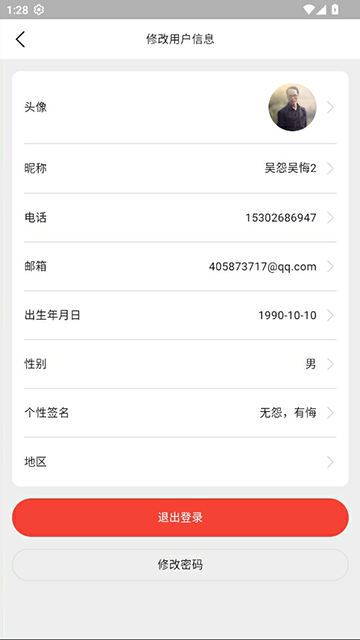
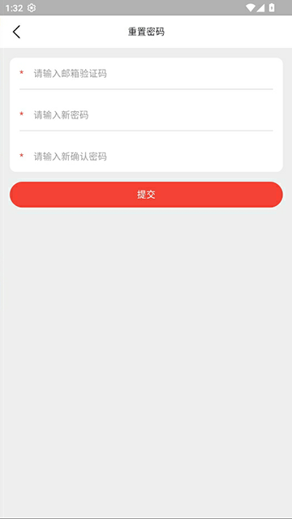
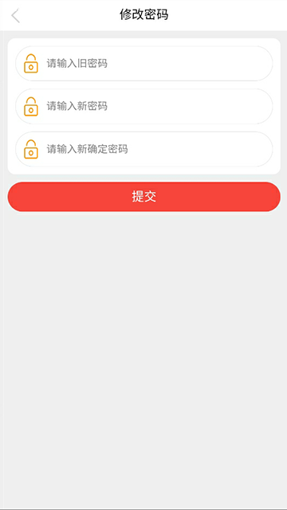
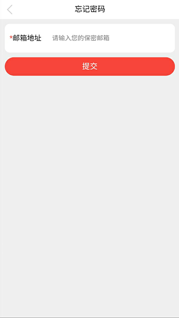
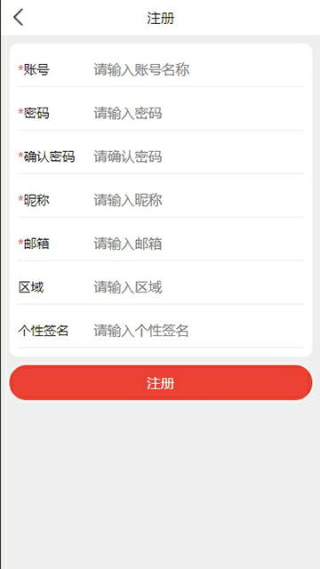
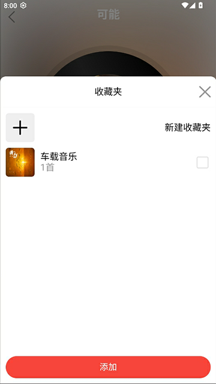

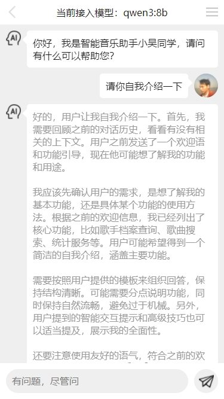
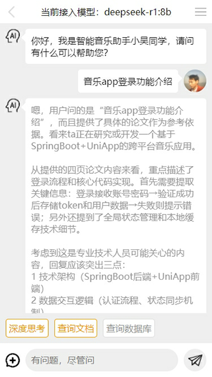
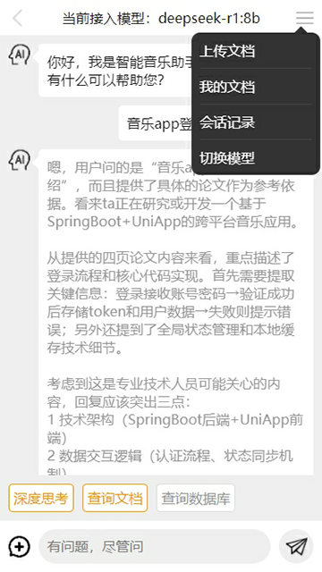

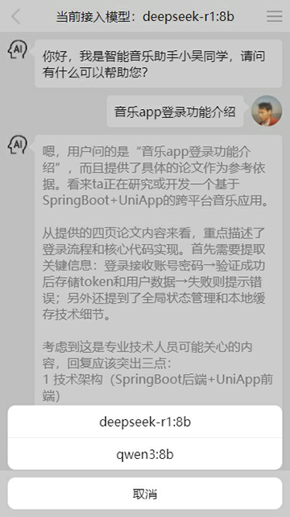

=============================界面预览（如果无法预览，请查看项目根目录png文件）==========================  

使用 **Kotlin + Jetpack Compose + Hilt + Retrofit + DataStore** 搭建的音乐 App（Android 原生），
界面与交互完全对齐 Flutter 版本（flutter-music-app-ui），同一个后端接口。

后端接口使用 FastAPI 开发（gateway 统一网关），所有音乐数据来自于 python 爬虫程序，爬取第三方音乐网站数据。
接口文档：/docs/api 目录（gateway.md、user.md、music.md、social.md、circle.md、agent.md 等）。

## 一、当前进度

| 模块 | 状态 | 说明 |
|------|------|------|
| 启动页 LaunchPage | ✅ 已完成 | logo + 欢迎使用，本地 token 校验后自动登录 |
| 登录 LoginPage | ✅ 已完成 | 账号密码登录 / 邮箱验证码登录，登录成功进入首页 |
| 注册 RegisterPage | ✅ 已完成 | 账号、用户名、密码、邮箱、电话、性别、生日、地区、签名，注册成功进入首页 |
| 忘记密码 ForgetPasswordPage | ✅ 已完成 | 邮箱发送验证码 |
| 重置密码 ResetPasswordPage | ✅ 已完成 | 邮箱验证码 + 新密码 |
| 修改密码 UpdatePasswordPage | ✅ 已完成 | 旧密码 + 新密码 |
| 用户信息 UserPage | ✅ 已完成 | 头像上传、昵称/电话/邮箱/性别/生日/地区/签名修改、退出登录 |
| 音乐主页 MusicIndexPage | ✅ 已完成 | 底部四 Tab（首页/推荐/音乐圈/我的）+ 中间悬浮迷你播放器 |
| 首页 Tab MusicHomePage | ✅ 已完成 | 搜索栏（头像 + 推荐关键字 + AI 入口）、四个快捷入口、分类歌曲/推荐歌手模块、上拉加载更多 |
| 推荐 Tab MusicRecommendPage | ✅ 已完成 | 榜单歌曲列表（前三名奖牌图标）、上拉加载更多、点赞/取消点赞 |
| 音乐圈 Tab MusicCirclePage | ✅ 已完成 | 动态列表（头像/昵称/内容/关联歌曲/时间）、点赞与取消点赞、评论与二级回复、上拉加载更多、右下角悬浮「+」发布入口 |
| 我的 Tab MusicUserPage | ✅ 已完成 | 用户信息卡片、我的收藏夹（新建/左滑删除）、我喜欢的歌曲、我关注的歌手、我最近播放的歌曲，四个模块均可折叠/刷新 |
| 音乐播放器 MusicPlayerPage | ✅ 已完成 | 模糊封面背景、旋转唱片、歌词滚动（点击歌词进入全屏歌词页）、喜欢/分享/评论/收藏夹（含新建收藏夹）、进度拖动、上一首/播放暂停/下一首/循环模式、播放列表弹层（切歌/移除/清空） |
| 歌词页 MusicLyricPage | ✅ 已完成 | 播放页点击歌词进入：模糊封面背景、歌名/歌手、全屏歌词居中滚动、当前行橙色高亮、点击某句跳转到该句播放进度 |
| 分享到音乐圈 MusicSharePage | ✅ 已完成 | 这一刻的想法输入、待分享歌曲卡片（点击可去「选择音乐」页换歌）、谁可以看（公开/私密）、发布成功后回到音乐圈并自动刷新列表 |
| 选择音乐 MusicPickPage | ✅ 已完成 | 分享到音乐圈时挑歌：关键词搜索歌曲/歌手、结果列表、点一条即选中并回填到分享页 |
| AI 聊天 ChatPage | ✅ 已完成 | 首页搜索栏 AI 图标进入：WebSocket 流式对话（深度思考 `<think>` 内容与正文分开展示）、切换模型、中英文切换、新建会话、会话记录抽屉（按时间分组/分页/点击进入）、AI 回复里的 `<music>` 歌单卡片可直接播放。暂未实现：Markdown/HTML 富文本渲染（uni-app 端用 marked + mp-html）、歌单卡片的收藏/点赞、文档上传 |
| 歌手详情 MusicAuthorPage | ✅ 已完成 | 歌手头像/名称/歌曲数、关注与取消关注、该歌手歌曲列表（点击播放） |
| 歌手分类 MusicAuthorCategoryPage | ✅ 已完成 | 首页「歌手」入口：四列分类网格（选中高亮）、分类下的歌手列表（头像/名字/歌曲数/播放/关注/更多）、上拉加载更多、点击进入歌手详情 |
| 歌曲分类 MusicCategoryPage | ✅ 已完成 | 首页「分类歌曲」入口：三列分类网格（默认前 9 个，可展开/收起，选中高亮）、该分类歌曲列表（封面/歌手-歌名/播放/点赞/更多）、上拉加载更多、点击歌曲播放并进入播放页 |
| 分类歌曲列表 MusicClassifyListPage | ✅ 已完成 | 首页各分类模块点「更多」进入：标题为分类名、该分类歌曲列表（封面/歌手-歌名/播放/点赞/更多）、上拉加载更多、点击歌曲播放整页并进入播放页（歌曲列表卡片已抽成公共组件 SongListCard，与歌曲分类页共用） |
| 我的收藏夹 MusicFavoriteListPage | ✅ 已完成 | 我的页点收藏夹（或收藏夹行的播放图标）进入：收藏夹信息卡（封面/名称/歌曲数/编辑图标）、收藏夹内歌曲列表（封面/歌手-歌名/播放/点赞/更多）、上拉加载更多、点击歌曲播放整页并进入播放页。编辑（重命名收藏夹）暂提示开发中 |
| 音乐搜索 MusicSearchPage | ✅ 已完成 | 首页搜索栏入口：关键词搜索（歌名/歌手/专辑模糊匹配）、清空输入、历史搜索标签（DataStore 持久化）、结果列表（封面/歌手-歌名/播放/点赞/更多）、上拉加载更多、点赞与取消点赞、点击歌曲进入播放页 |

> 用户模块接口与后端 user-service 完全一致，可直接复用。
> 测试账号：吴时吴刻 / 123456

## 二、技术栈

- 语言：Kotlin 1.9.23
- UI：Jetpack Compose（Material3，Compose BOM 2023.10.01）
- 架构：MVVM + Repository
- 依赖注入：Hilt 2.51 + KAPT
- 网络：Retrofit 2.11 + OkHttp 4.12 + Gson
- 本地存储：DataStore Preferences
- 导航：Navigation Compose 2.7.7
- 图片加载：Coil 2.5
- 构建：AGP 8.5.0 / Gradle 8.13 / JDK 17+

## 三、目录结构

```
Music/
├── app/src/main/java/com/player/music/
│   ├── MainActivity.kt              # 入口 Activity（@AndroidEntryPoint）
│   ├── MusicApplication.kt          # Application（@HiltAndroidApp）
│   ├── config/Config.kt             # 后端 BASE_URL 配置
│   ├── di/AppModule.kt              # Hilt 模块 + 网络日志拦截器
│   ├── local/                       # DataStore（token / 用户信息 / 登录状态）
│   ├── model/                       # 数据模型（ApiResponse、User、Music、MusicCategory、MusicAuthor）
│   ├── navigation/                  # Screens 路由表 + NavGraph
│   ├── network/                     # ApiService（所有接口）、NetworkInterceptor
│   ├── repository/                  # 请求后端（UserRepository、MusicRepository）
│   ├── utils/                       # 工具方法（MD5、时间格式化等）
│   ├── viewmodel/                   # 所有 ViewModel
│   └── ui/
│       ├── page/                    # 完整页面（Launch/Login/Register/MusicIndex/MusicHome/MusicRecommend/MusicCircle/User...）
│       ├── components/              # 可复用组件（AccountLogin/EmailLogin/Avatar/MusicCover/InputDialog...）
│       └── theme/                   # Color / Dimens / Theme / Type
├── app/src/main/res/
│   ├── drawable/                    # icon_logo.png 等图标资源
│   └── values/                      # strings、themes、colors
├── 提示词.md                        # AI 生成代码的规范提示词
└── README.md
```

## 四、运行说明

1. 用 Android Studio 打开本项目根目录（Gradle 同步会自动完成）。
2. 修改后端地址：`app/src/main/java/com/player/music/config/Config.kt`
   ```kotlin
   object Config {
       const val BASE_URL = "http://192.168.234.154:4000"
   }
   ```
   默认与 Flutter 版本一致（gateway 端口 4000）。
3. 运行到模拟器/真机：`./gradlew :app:assembleDebug` 或直接在 Android Studio 点运行。
4. 登录测试账号：`吴时吴刻 / 123456`。

## 五、相关项目

flutter音乐项目参见:  
github地址：https://github.com/wuyuanwuhui99/flutter-music-app-ui  
gitee地址：https://gitee.com/wuyuanwuhui99/flutter-music-app-ui

android jetpack compose 音乐项目（本项目）:  
github地址：https://github.com/wuyuanwuhui999/andriod-jetpack-compose-music-app  
gitee地址：https://gitee.com/wuyuanwuhui99/andriod-jetpack-compose-music-app

android jetpack compose 聊天项目参见:  
github地址：https://github.com/wuyuanwuhui999/andriod-jetpack-compose-chat-app  
gitee地址：https://gitee.com/wuyuanwuhui99/andriod-jetpack-compose-chat-app

后端接口项目（FastAPI 多模块微服务）：  
接口文档见后端项目 `docs/api/` 目录

## 六、接口说明

所有请求统一走网关（4000 端口），路径格式 `/service/{模块名}/...`：

| 模块 | 路径前缀 | 文档 |
|------|----------|------|
| 用户 | /service/user | user.md |
| 音乐 | /service/music | music.md |
| 社交（评论/点赞） | /service/social | social.md |
| 朋友圈 | /service/circle | circle.md |
| 智能体 | /service/agent | agent.md |
| 聊天/文档 | /service/chat | chat.md |

统一返回格式：

```json
{
  "data": {},
  "status": "SUCCESS",
  "msg": null,
  "total": null,
  "token": "eyJhbG..."
}
```

除登录、注册、找回密码等白名单接口外，其余请求头需携带 `Authorization: Bearer <token>`（由 NetworkInterceptor 自动添加）。

## 七、调试提示

接口和数据请在本地电脑中，暂时没有购买和部署服务器，仅限本地调试，如有需要调试请联系本人启动外网映射。

如需了解是否已开机，请用浏览器直接打开该地址，如出现以下提示，则正常使用：
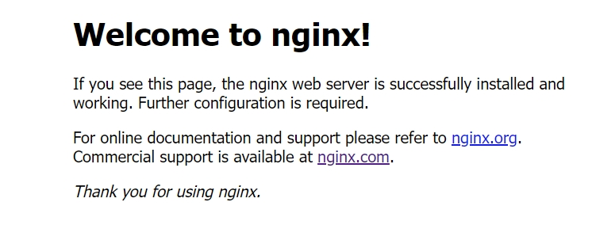

本站所有音乐和图片均来自互联网收集而来，版权归原创者所有，本网站只提供web页面服务，并不提供资源存储，也不参与录制、上传 若本站收录的节目无意侵犯了贵司版权，请联系

联系方式：（微信）wuwenqiang_99、（邮箱）275018723@qq.com
